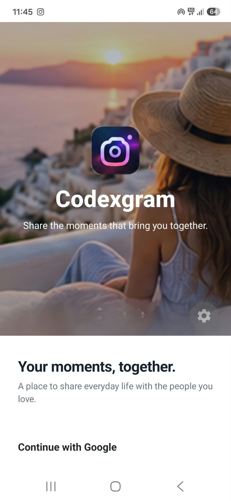
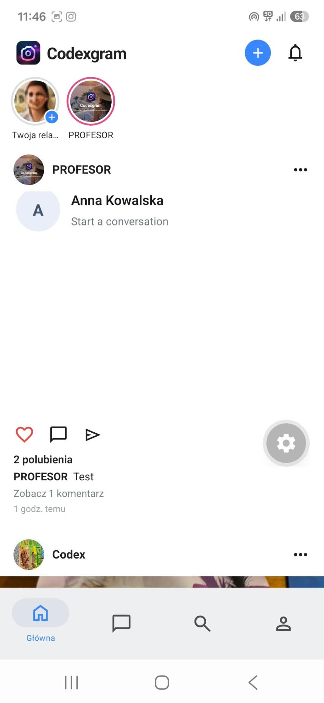
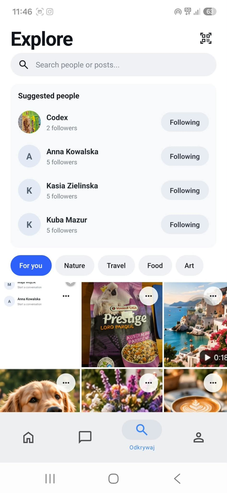
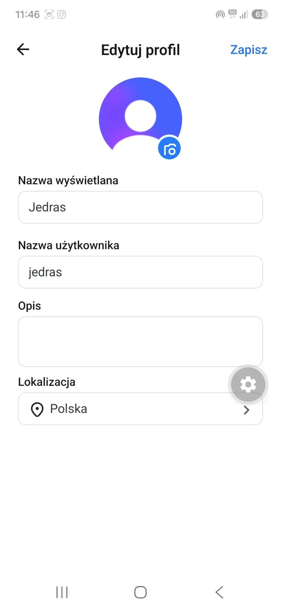
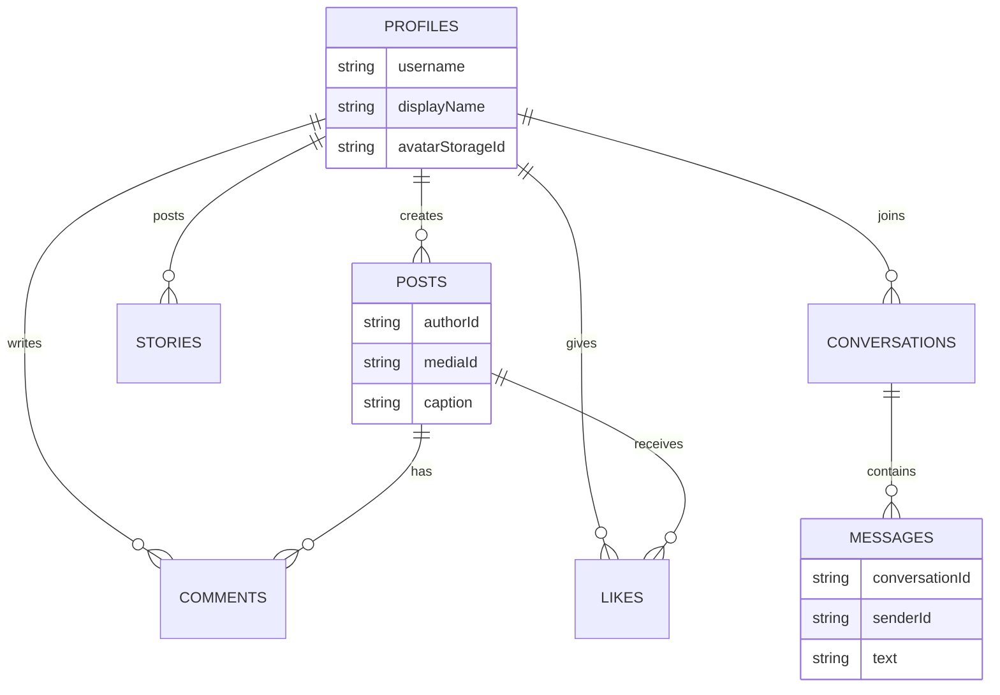

# Codexgram 📸

Nowoczesna aplikacja społecznościowa (mobile-first) zbudowana w oparciu o React Native (Expo) i Convex. Aplikacja umożliwia udostępnianie zdjęć, wchodzenie w interakcje, prowadzenie rozmów w czasie rzeczywistym oraz dodawanie relacji (Stories).

## 🔗 Live Demo (Pobierz Aplikację)
Aplikację można przetestować na urządzeniach z systemem Android. Pobierz plik instalacyjny (.apk) pod poniższym linkiem:
👉 **[Pobierz Codexgram (APK)](https://drive.proton.me/urls/7YPNDXHJPW#m6G2DDoglZky)**

**🎥 Wideo prezentujące działanie aplikacji:**
👉 **[Zobacz wideo na YouTube](https://www.youtube.com/watch?v=Fg6Rc_Q6Fgc)**

**🔑 Konto testowe:**
Aby przetestować aplikację z gotowymi danymi, zaloguj się za pomocą:
*   **E-mail:** `profesor.test@proton.me`

*(Uwaga: Hasło do konta testowego oraz do skrzynki e-mail – wymaganej do odebrania kodu weryfikacyjnego – zostały przekazane prowadzącemu w prywatnej wiadomości / na zajęciach. Możesz też użyć przycisku "Continue with Google" i założyć własne konto).*

## ✨ Główne funkcjonalności
*   **Uwierzytelnianie:** Logowanie przez Google OAuth oraz e-mail/hasło (Clerk).
*   **Onboarding:** Wybór unikalnego username, nazwy wyświetlanej i avatara.
*   **Feed (Home):** Chronologiczny widok postów obserwowanych osób.
*   **Interakcje:** Polubienia, komentarze, system obserwowania (Follow).
*   **Wiadomości:** Czat 1:1 w czasie rzeczywistym (real-time).
*   **Stories:** Dodawanie zdjęć, które wygasają po 24 godzinach.
*   **Lokalizacja (i18n):** Zmiana języka interfejsu (PL/EN) na podstawie lokalizacji w profilu.
*   **Zarządzanie kontem:** Edycja profilu oraz pełne usuwanie konta z bazy (Convex + Clerk API).

## 📱 Zrzuty ekranu (Screenshots)

| Ekran powitalny | Ekran główny (Home) |
| :---: | :---: |
|  |  |

| Explore | Edycja profilu |
| :---: | :---: |
|  |  |

## 📄 Dokumenty prawne i Landing Page
W ramach projektu przygotowałem również statyczne strony HTML z dokumentami prawnymi oraz stronę wizytówkę (Landing Page). Znajdują się one w folderze **`legal/`**:
*   `landing.html` – strona wizytówka aplikacji (prezentacja projektu).
*   `privacy.html` – Polityka Prywatności.
*   `terms.html` – Regulamin (Terms of Service).

**Jak je zobaczyć?**
Aby wyświetlić te strony w formie graficznej (a nie jako kod źródłowy), wystarczy pobrać repozytorium lub otworzyć pliki lokalnie i kliknąć w nie dwukrotnie (otworzą się w domyślnej przeglądarce). Można je również uruchomić za pomocą rozszerzenia "Live Server" w VS Code.

## 🛠 Stack Technologiczny
*   **Frontend:** React Native, Expo SDK 57, Expo Router, NativeWind (Tailwind CSS).
*   **Backend & Baza Danych:** Convex (Cloud Functions, Database, File Storage).
*   **Autoryzacja:** Clerk (OAuth, JWT).
*   **Język:** TypeScript.

### 🗄️ Architektura Bazy Danych (Convex)
Poniższy diagram przedstawia relacje między głównymi tabelami w bazie Convex:

### 🗄️ Architektura Bazy Danych (Convex)
Poniższy diagram przedstawia relacje między głównymi tabelami w bazie Convex:

    🚀 Uruchomienie lokalne

    Sklonuj repozytorium: git clone https://github.com/jedraszek2-jpg/codexgram.git

    Zainstaluj zależności: npm install

    Skopiuj plik .env.example do .env.local i uzupełnij wymagane klucze (Clerk Publishable Key, Convex URL, Clerk Secret Key).

    Uruchom backend Convexa: npx convex dev

    Uruchom aplikację w drugim terminalu: npx expo start --dev-client

📦 Wdrożenie (CI/CD)

Projekt wykorzystuje EAS Build (Expo Application Services) do budowania plików instalacyjnych w chmurze. Każdy nowy build dla Androida generowany jest komendą:
npx eas-cli@latest build --platform android --profile preview
🤖 Wykorzystanie AI

Szczegółowy raport z wykorzystania narzędzi AI (Codex, GitHub Copilot) oraz opis wyzwań i procesu "Human-in-the-loop" znajduje się w pliku AI_Usage.md.