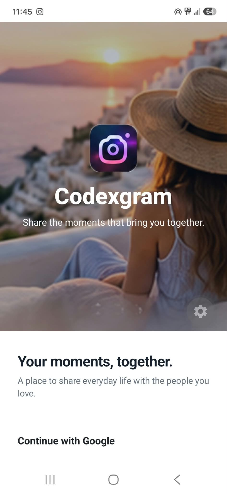
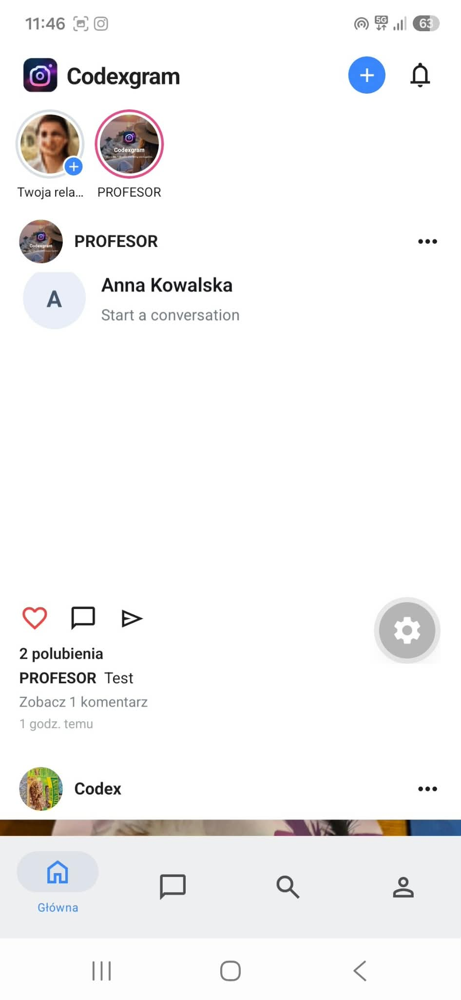
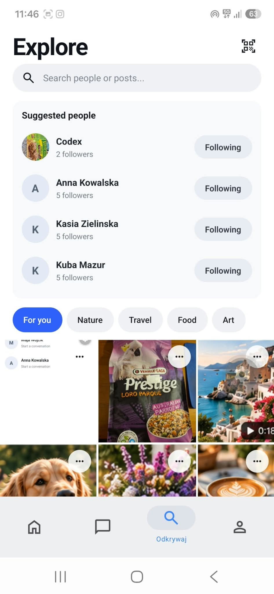
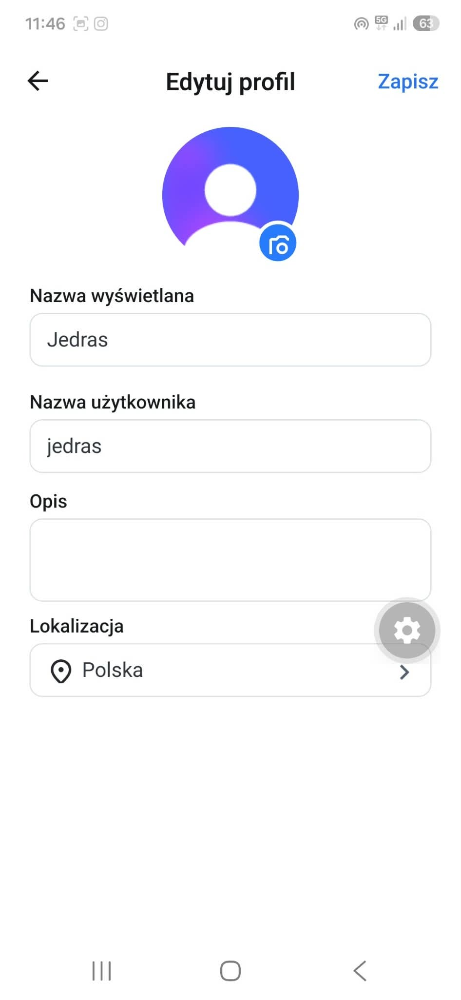
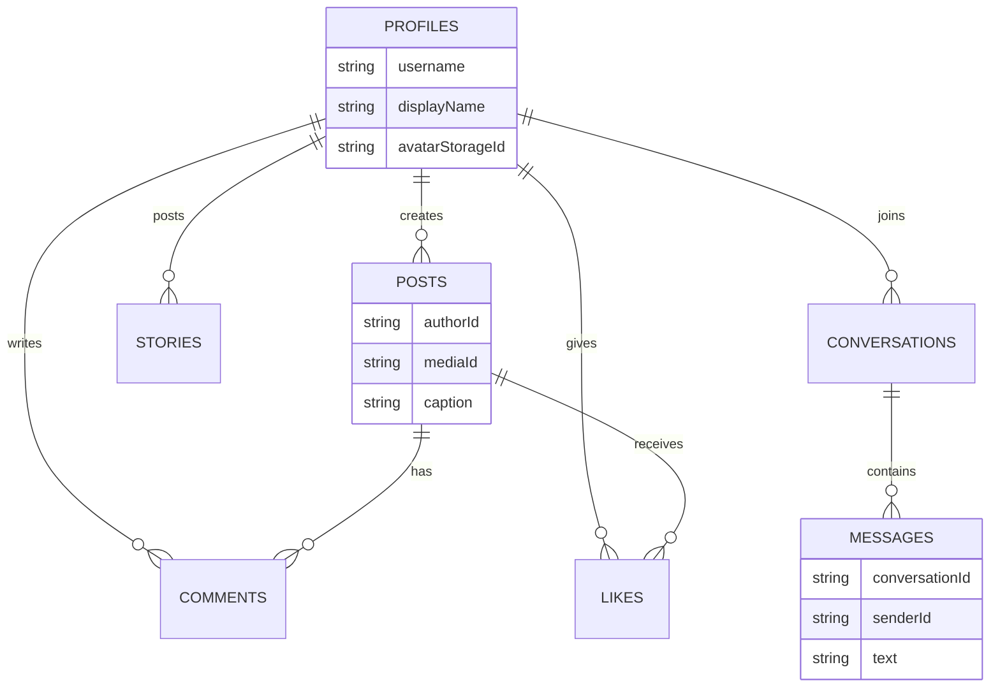

# Codexgram 📸

Nowoczesna aplikacja społecznościowa (mobile-first) zbudowana w oparciu o React Native (Expo) i Convex. Aplikacja umożliwia udostępnianie zdjęć, wchodzenie w interakcje, prowadzenie rozmów w czasie rzeczywistym oraz dodawanie relacji (Stories).

## 🔗 Live Demo (Pobierz Aplikację)
Aplikację można przetestować na urządzeniach z systemem Android. Pobierz plik instalacyjny (.apk) pod poniższym linkiem:
👉 **[Pobierz Codexgram (APK)](https://drive.proton.me/urls/YJQ7HFT88M#yLpzGzcGVrab)**

## 🛠️ Instrukcja uruchomienia (Wersja Deweloperska)

Pobrany plik `.apk` to tzw. **Development Build**. Oznacza to, że aplikacja na telefonie jest jedynie "skorupą", która do działania wymaga połączenia z serwerem uruchomionym na komputerze. Aby przetestować aplikację, wykonaj poniższe kroki:

### Wymagania wstępne:
*   Zainstalowany **Node.js** na komputerze.
*   Telefon z Androidem i komputer podłączone do **tej samej sieci Wi-Fi**.
*   Zainstalowana aplikacja **Codexgram** na telefonie (z pobranego pliku APK).

### Krok 1: Pobranie i konfiguracja projektu
1. Sklonuj repozytorium na komputer: `git clone https://github.com/jedraszek2-jpg/codexgram.git`
2. Przejdź do folderu projektu: `cd codexgram`
3. Zainstaluj zależności: `npm install`
4. Skopiuj plik `.env.example` i zmień jego nazwę na `.env.local`.
5. **Bardzo ważne:** W pliku `.env.local` uzupełnij klucze środowiskowe (Clerk Publishable Key, Convex URL). *Ze względów bezpieczeństwa klucze te zostały przekazane prowadzącemu w prywatnej wiadomości.*

### Krok 2: Uruchomienie serwerów (wymagane dwa terminale)
Otwórz terminal w folderze projektu.

**Terminal 1 (Backend):**
```bash
npx convex dev

**Terminal 2 (Frontend):**
npx expo start --dev-client

Krok 3: Połączenie telefonu z komputerem

    Otwórz zainstalowaną aplikację Codexgram na telefonie.

    W terminalu z Expo pojawi się kod QR. Zeskanuj go za pomocą aplikacji Codexgram (jeśli aplikacja nie ma wbudowanego skanera, możesz wpisać ręcznie adres IP wyświetlony w terminalu, np. exp://192.168.1.xxx:8081).

    Po chwili aplikacja załaduje się i będziesz mógł się zalogować.

(Jeśli aplikacja nie chce się połączyć, upewnij się, że komputer i telefon są w tej samej sieci, a zapora Windows nie blokuje połączenia z Node.js).

**🎥 Wideo prezentujące działanie aplikacji:**
👉 **[Zobacz wideo na YouTube](https://www.youtube.com/watch?v=Fg6Rc_Q6Fgc)**

**🔑 Konto testowe:**
Aby przetestować aplikację z gotowymi danymi, zaloguj się za pomocą:
*   **E-mail:** `profesor.test@proton.me`

*(Uwaga: Hasło do konta testowego oraz do skrzynki e-mail – wymaganej do odebrania kodu weryfikacyjnego – zostały przekazane prowadzącemu w prywatnej wiadomości / na zajęciach. Możesz też użyć przycisku "Continue with Google" i założyć własne konto).*

## ✨ Główne funkcjonalności
*   **Uwierzytelnianie:** Logowanie przez Google OAuth oraz e-mail/hasło (Clerk).
*   **Onboarding:** Wybór unikalnego username, nazwy wyświetlanej i avatara.
*   **Feed (Home):** Chronologiczny widok postów obserwowanych osób.
*   **Interakcje:** Polubienia, komentarze, system obserwowania (Follow).
*   **Wiadomości:** Czat 1:1 w czasie rzeczywistym (real-time).
*   **Stories:** Dodawanie zdjęć, które wygasają po 24 godzinach.
*   **Lokalizacja (i18n):** Zmiana języka interfejsu (PL/EN) na podstawie lokalizacji w profilu.
*   **Zarządzanie kontem:** Edycja profilu oraz pełne usuwanie konta z bazy (Convex + Clerk API).

## 📱 Zrzuty ekranu (Screenshots)

| Ekran powitalny | Ekran główny (Home) |
| :---: | :---: |
|  |  |

| Explore | Edycja profilu |
| :---: | :---: |
|  |  |

## 📄 Dokumenty prawne i Landing Page
W ramach projektu przygotowałem również statyczne strony HTML z dokumentami prawnymi oraz stronę wizytówkę (Landing Page). Znajdują się one w folderze **`legal/`**:
*   `landing.html` – strona wizytówka aplikacji (prezentacja projektu).
*   `privacy.html` – Polityka Prywatności.
*   `terms.html` – Regulamin (Terms of Service).

**Jak je zobaczyć?**
Aby wyświetlić te strony w formie graficznej (a nie jako kod źródłowy), wystarczy pobrać repozytorium lub otworzyć pliki lokalnie i kliknąć w nie dwukrotnie (otworzą się w domyślnej przeglądarce). Można je również uruchomić za pomocą rozszerzenia "Live Server" w VS Code.

## 🛠 Stack Technologiczny
*   **Frontend:** React Native, Expo SDK 57, Expo Router, NativeWind (Tailwind CSS).
*   **Backend & Baza Danych:** Convex (Cloud Functions, Database, File Storage).
*   **Autoryzacja:** Clerk (OAuth, JWT).
*   **Język:** TypeScript.

## 📡 Dokumentacja API (Convex Functions)
Zamiast tradycyjnych endpointów REST, aplikacja wykorzystuje funkcje serverless w Convex. Oto najważniejsze z nich:

*   **Queries (Odczyt danych):**
    *   `api.social.myProfile` – pobiera profil zalogowanego użytkownika.
    *   `api.social.homeFeed` – pobiera posty obserwowanych użytkowników.
    *   `api.messages.getMyConversations` – pobiera listę czatów.
    *   `api.stories.getActiveStories` – pobiera aktywne historie (młodsze niż 24h).
*   **Mutations (Zapis danych):**
    *   `api.social.createPost` – dodaje nowy post.
    *   `api.social.toggleLike` – dodaje/usuwa polubienie.
    *   `api.messages.sendMessage` – wysyła wiadomość na czacie.
    *   `api.users.deleteMyAccount` – usuwa konto i wszystkie dane (Convex + Clerk).

### 🗄️ Architektura Bazy Danych (Convex)
Poniższy diagram przedstawia relacje między głównymi tabelami w bazie Convex:

### 🗄️ Architektura Bazy Danych (Convex)
Poniższy diagram przedstawia relacje między głównymi tabelami w bazie Convex:



    🚀 Uruchomienie lokalne

    Sklonuj repozytorium: git clone https://github.com/jedraszek2-jpg/codexgram.git

    Zainstaluj zależności: npm install

    Skopiuj plik .env.example do .env.local i uzupełnij wymagane klucze (Clerk Publishable Key, Convex URL, Clerk Secret Key).

    Uruchom backend Convexa: npx convex dev

    Uruchom aplikację w drugim terminalu: npx expo start --dev-client

📦 Wdrożenie (CI/CD)

Projekt wykorzystuje EAS Build (Expo Application Services) do budowania plików instalacyjnych w chmurze. Każdy nowy build dla Androida generowany jest komendą:
npx eas-cli@latest build --platform android --profile preview
🤖 Wykorzystanie AI

Szczegółowy raport z wykorzystania narzędzi AI (Codex, GitHub Copilot) oraz opis wyzwań i procesu "Human-in-the-loop" znajduje się w pliku AI_Usage.md.

